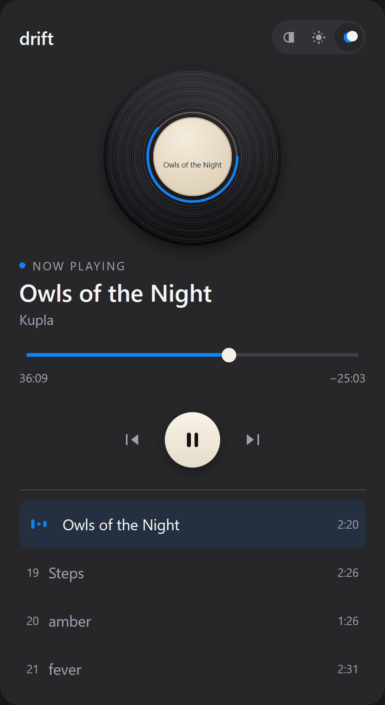
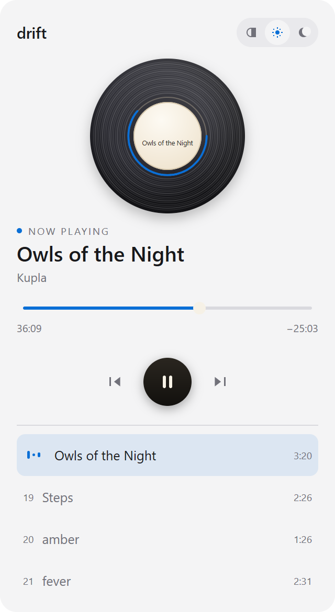

# drift

A lo-fi mix player that lives in the Windows system tray.

Click the tray icon. A small popup opens with a record on it. Press play. Close
the popup and the music keeps going.




## What it does

It streams one continuous recording from your disk and cuts it into chapters.
Twenty-eight markers sit at the timestamps of the tracklist, so the title
follows the music as the mix moves from song to song.

The popup is 320 by 585 pixels. That is the size of the panels Windows already
shows from the tray, and I kept to it.

It draws its own interface. There is no browser engine inside, no HTML, no
download.

## What it does not do

It does not download music. It plays a file you already have.

It does not ship audio. The recording belongs to the artists in it.

## Requirements

- Windows 10 or 11
- An audio file you have the right to play: MP3, Ogg or WAV
- To build: Go 1.27.3 or later

## Install

Download `drift-setup-0.1.0-amd64.exe` from the releases page and run it.

The app starts in the tray. It shows no window until you click the icon.

## Build

```powershell
cd desktop
go tool mygo build
```

The installer lands in `desktop\dist\windows-amd64\`.

To run it while you change it:

```powershell
cd desktop
go build -o drift-dev.exe .
.\drift-dev.exe
```

## Use

Left-click the icon to open the popup. Left-click again to close it. The music
carries on.

Right-click for a menu: open, choose a mix, play or pause, next chapter, quit.

Inside the popup:

| Key | Action |
| --- | --- |
| Space | play or pause |
| Left, Right | seek five seconds |
| Shift + Left, Right | previous or next chapter |
| Escape | close the popup |

Drag the seek bar to move through the mix. Click any chapter to play it.

The three marks at the top right pick the appearance: follow Windows, light, or
dark. The app remembers your choice.

## How it works

```
desktop/
  main.go                   tray, popup, file picker, saved settings
  internal/mix/tracks.go    the 28 chapters: offsets, artists, titles
  internal/player/          streams the file, seeks, tracks the chapter
  internal/view/            the screen, the record, the controls, the theme

mockup/
  index.html, styles.css    the browser version this app is drawn from
  src/                      its player, record and tracklist
```

Three parts matter.

**The player outlives the popup.** Audio lives in Go, not in the window. Closing
the popup destroys the window and leaves the playback untouched.

**The recording streams.** A 61 minute stereo file would take 1.2 GB as float
samples in memory. `audio.OpenStream` decodes it as it plays and seeks inside
the file, so memory stays flat.

**The record is drawn, not loaded.** A painter draws the disc, its grooves, the
label and the progress ring every frame. The disc turns and the label print
stays level, because a rotated title is unreadable in a still frame.

## Chapter data

The tracklist lives in `desktop/internal/mix/tracks.go` as 28 offsets. I checked
every offset against the recording: each one lands in a quiet gap between two
songs, between 11 and 74 dB below the music around it.

If you use a different recording, the offsets will not line up. Edit that file
to match yours.

## Tests

```powershell
cd desktop
go test ./...
```

The tests that matter build the real screen and drive it. `TestScreenScrolls`
sends wheel events to the chapter list. `TestStreamRealRecording` seeks your
file and checks the chapter it lands on.

To run the tests against a recording:

```powershell
$env:DRIFT_MIX = "C:\path\to\your\mix.mp3"
go test ./...
```

## Built with

[MyGo](https://mygo.egoist.dev), a Go desktop framework that draws its own
interface. Version 0.7.4.

The record turns with `Element.Loop`. The seek bar is `SliderBase`, the buttons
are `ButtonBase`, and the appearance switch is `SegmentedBase`, so each one
handles the keyboard, focus and screen readers without extra code.

## Licence

The code is MIT. The music is not mine to license.
